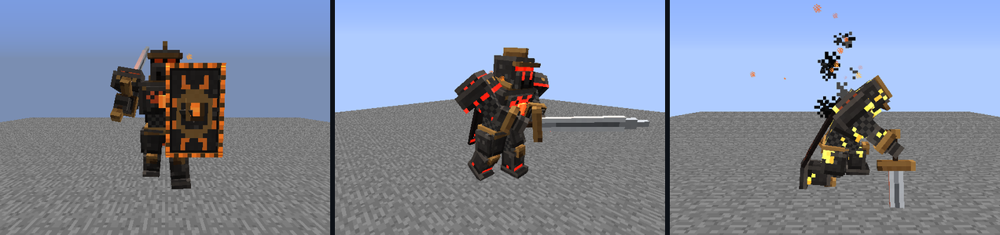
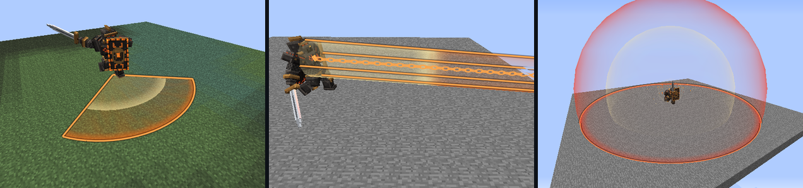
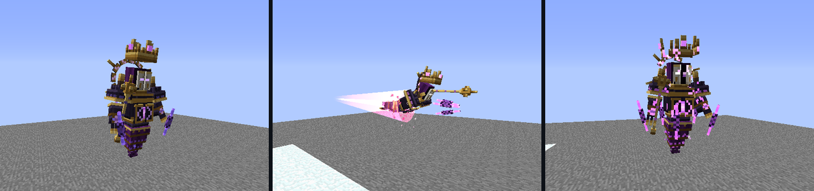
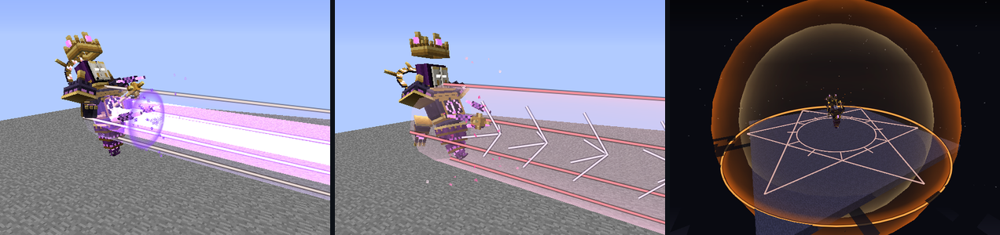

# Hexxit Boss Lab

Hand-built boss fights for the Hexxit modpack (Minecraft 1.5.2), designed against an endgame character and tested in the real game.

Every attack is warned, every warning matches the blow exactly, and no simple pattern wins safely.

## The bosses

### The Ashen Warden



V1 demo:

https://github.com/user-attachments/assets/72006dfb-1505-492c-85c1-4799b76caa23

An armoured duelist with a shield that turns your blows aside until it commits to a strike. Bait an attack, dodge it, and punish the opening.

- **Tracking warnings.** Each strike follows you faintly, aimed at where you are heading, then flares and locks. Keep moving the same way and you walk into it; change direction and you escape.
- **Posture.** Clean hits during its openings build posture until it breaks and drops to one knee, open to heavier blows.
- **Combos that read you.** Cleaves, Backhands, Slams, Leaps, and a Chain Hook that reels you in. Hammering its shield earns a Shield Bash; standing out of reach earns a Leap.
- **The Cinder swarm.** Wounded, it raises Cinders whose ash smothers your healing, then reclaims them for an Ash Nova that grows with every Cinder you fail to shoot down. Its guard shatters, and it fights on faster than you can run.



[Guide](docs/bosses/warden.md)

### The Hexbound Sovereign



V1 demo:

https://github.com/user-attachments/assets/d0b609b7-789f-44a4-ae15-35822c3a74b0

A hooded, faceless king held together by hex magic. Its crown, halo, gauntlets, sceptre, and crystal shards float free of its body, and where they drift tells you what it is about to do. It fights from the air.

- **Hex Lance.** The sceptre swings onto a line and spins up, then fires a beam up to 64 blocks long. Sidestep.
- **Ruin Rush.** It rears back, its shards form a drill, and it charges along a corridor for 100 damage. Leave the route.
- **Crown Break.** Its crown lifts and parts, a hexagram burns on the ground, and an 18-block sphere detonates. Get out or get behind cover. Circling it close is what calls this down.
- **Exposed.** After every attack it slumps, its chest plates open, and its core blazes: your moment to strike.
- **Coming apart.** Each phase cracks it further, until the crown is broken, the mask split, and the halo missing pieces.



[Guide](docs/bosses/sovereign.md)

## Design

The fights are built for a character with free flight, instant teleport, revival feathers, and nearly endless healing. Against that kit, a fight only matters if no simple pattern wins safely. Every playtest exploit, such as circling, kiting with a bow, or out-healing the damage, becomes a rule and an automated regression. See [encounter design](docs/encounter-design.md).

## Running it

This is a personal lab rather than a packaged mod: it installs into one local Prism copy of Hexxit 1.0.11 on Windows, and never touches the original instance or saves.

```powershell
.\lab.ps1 setup   # create the isolated lab instance and world, once
.\lab.ps1 play    # build, install, and launch; then /bosslab warden
```

In game: `/bosslab checkpoint` to save your gear, `/bosslab warden` or `/bosslab sovereign` to summon, `/bosslab retry` for a rematch from the checkpoint, and `/bosslab clear` to end a fight. `/bosslab help` lists everything; see [practice rematches](docs/practice.md).

## How it is built

Java 6 code for Forge 7.8.1.737, compiled with JDK 11 through Gradle and Voldeloom. A separate test mod plays scripted fights in the real modpack, including dodges, exploits, deaths, and save/reload, and photographs every boss state. See [development](docs/development.md) and [testing](docs/testing.md).
